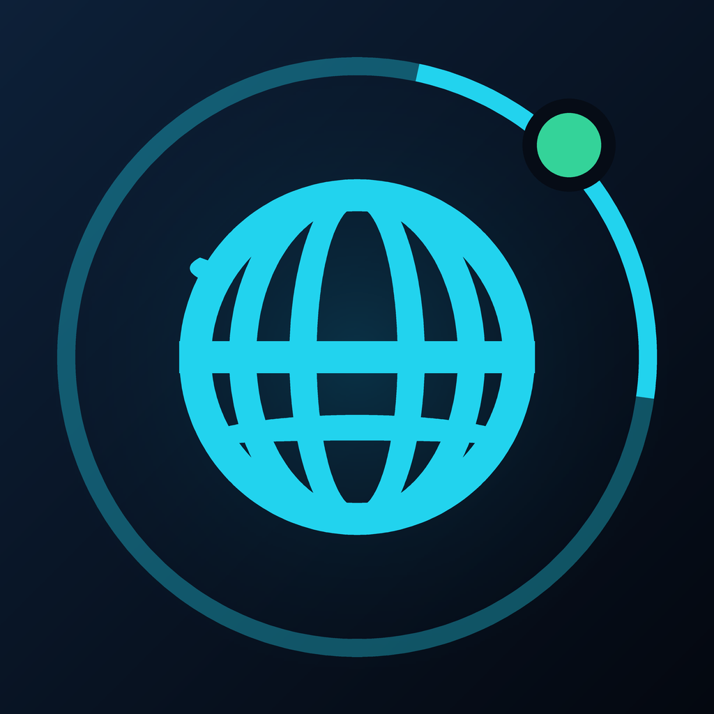

<p align="center">
  
</p>

<h1 align="center">圆表浏览器 · Wear Browser</h1>

<p align="center">
  适配<b>圆形表盘</b>的 Wear OS 轻量浏览器<br/>
  网站比例适配 · 文件下载 · MD3 圆屏交互 · 性能优先
</p>

<p align="center">
  
  
  
  
</p>

---

## ✨ 功能

| 模块 | 说明 |
|------|------|
| 🌐 **浏览** | 系统 WebView 内核，全功能加载（JS / Cookie / 本地存储 / 媒体自动播放） |
| 📐 **比例适配** | 默认「适配宽度」渲染；菜单内 50%–200% 无级缩放，点百分比一键恢复适配宽度 |
| ⬇️ **文件下载** | 捕获网页附件下载（Content-Disposition / 未知类型），流式写盘 + 进度 + 取消/重试/删除 |
| 🔍 **地址栏** | 输入网址直接打开，输入关键词走搜索引擎（百度 / 必应 / 谷歌可切换） |
| ⭐ **书签 / 🕘 **历史**** | 本地持久化，历史自动去重、上限 300 条 |
| 🖥️ **桌面模式** | 一键切换桌面 User-Agent（运行时生效并重载） |
| ⌚ **圆屏交互** | MD3 深色主题、上下控制条按圆弧几何自动内缩、**旋转表冠滚动网页** |
| 💡 **浏览常亮** | 连接/阅读时屏幕不息屏（可在设置中关闭） |

## 🎯 圆屏适配设计

物理面板是圆的，落在圆外的内容会被裁掉。本应用按「可见纵向区间」计算左右最小内边距：

```
inset(y) = 屏宽/2 − √(R² − (y − R)²)    // R = min(宽,高)/2
```

- 顶部 URL 胶囊 / 底部控制条只放在 `[40px, 92px]`、`[H−88px, H−32px]` 的安全带内
- 列表 `contentPadding` 按整屏可见带动态计算，任何尺寸的圆形表盘（480/454/416/400px）自动适配
- 启动主题为深空黑，OLED 零烧屏友好、无亮白闪屏

## 🚀 构建 APK

推送到 `main` 分支后 GitHub Actions 自动构建：

1. 打开仓库 **Actions → 构建 APK**
2. 等待绿色 ✓（约 3–5 分钟）
3. 页面底部 **Artifacts** 下载 APK（zip 内 `app-release.apk`，保留 30 天）

本地构建：

```bash
flutter pub get
flutter analyze
flutter test
flutter build apk --release
# 产物: build/app/outputs/flutter-apk/app-release.apk
```

## ⌚ 安装到手表

```bash
adb install -r app-release.apk
```

或在手表上用 Wear Installer 类工具侧载（需开启 ADB 调试）。

**最低要求**：Wear OS 2.1+（Android 8.0 / API 26），建议 Wear OS 3+（Galaxy Watch 4 及之后）。

## 🕹️ 使用说明

| 操作 | 方式 |
|------|------|
| 打开网站 | 首页输入框输入网址 → 回车/箭头；或点快速访问磁贴 |
| 滚动网页 | **旋转表冠**（方向可在设置反转）或触屏滑动 |
| 缩放网页 | 浏览中点 **⋯ 菜单** → `−` / `+` 调整，点中间百分比恢复适配宽度 |
| 编辑网址 | 点顶部 URL 胶囊 |
| 下载文件 | 点网页中的下载链接，进度在 **首页 → 下载** 查看 |
| 下载目录 | `/storage/emulated/0/Android/data/dev.wearbrowser.app/files/Download/`（免权限） |

> 提示：下载列表中点按「已完成」的文件可复制其完整路径，方便 `adb pull`。

## 🧠 性能与稳定性（性能优先）

- **单 WebView 架构**：全局只有一个浏览页面，从根源上避免多标签 OOM 崩溃
- **禁止弹窗新窗口**：`supportMultipleWindows=false`，`target=_blank` 直接拦截
- **缓存开启、数据库关闭**：回访提速 + 省内存（DOM Storage 保留以兼容主流网站）
- **`largeHeap=true`**：给 WebView 更宽裕的堆空间，降低重型网页崩溃率
- **进度/URL/标题用 ValueNotifier 驱动**：加载过程中不触发整页 rebuild
- **退出即销毁**：离开浏览页销毁 WebView 并停止常亮；下载走独立流式管道，失败自动清理半截文件
- **外部 scheme 拦截**：`weixin:` / `tel:` / `intent:` 等手表无法处理的链接直接拦下并提示

## 📂 项目结构

```
lib/
├── main.dart                    # 入口 + MD3 主题挂载（AppScope 在 MaterialApp 外层）
├── theme.dart                   # MD3 深色主题（青色种子色）
├── state/app_state.dart         # 设置/书签/历史 + URL 解析 + 持久化
├── services/download_service.dart  # dio 流式下载（进度/取消/重试/去重命名）
├── pages/
│   ├── home_page.dart           # 首页：地址栏 + 快速访问 + 数据入口
│   ├── browser_page.dart        # 浏览器：WebView + 圆屏控制条 + 菜单
│   ├── list_pages.dart          # 书签 / 历史 / 下载 列表
│   └── settings_page.dart       # 设置
├── widgets/round_header.dart    # 圆屏安全区页头
└── util/
    ├── round_layout.dart        # 圆弧几何内缩计算
    ├── rotary.dart              # 表冠事件路由（栈式分发）
    └── wear_bridge.dart         # 原生通道（表冠/常亮）
android/app/src/main/kotlin/dev/wearbrowser/app/MainActivity.kt  # 表冠转发 + 常亮
tool/generate_icon.py            # 图标生成脚本（地球仪 + 表环）
```

## 📋 依赖

| 包 | 用途 |
|----|------|
| `flutter_inappwebview ^6.1.5` | WebView 内核（下载回调 / UA / 缩放 / 拦截） |
| `dio ^5.11.1` | 流式下载、进度、取消 |
| `shared_preferences` | 设置/书签/历史持久化 |
| `path_provider` | 下载目录定位 |

## 📜 License

[MIT](LICENSE) © 2026 圆表浏览器 (Wear Browser) contributors
